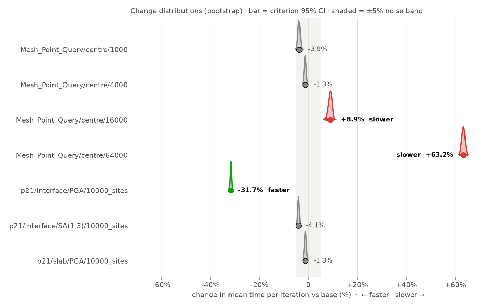
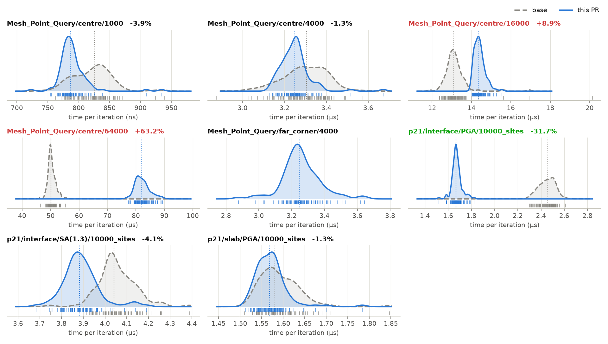
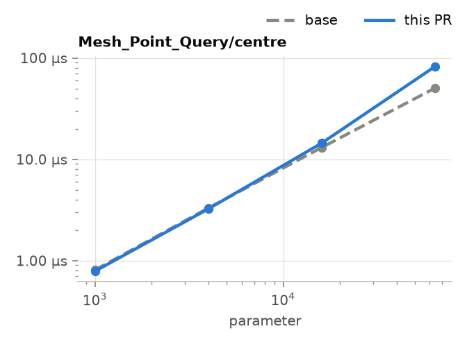
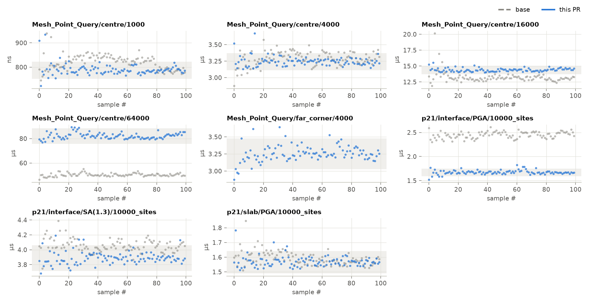

## ⏱️ Criterion benchmarks · `gm_models`

🔴 **2** slower · 🟢 **1** faster · ⚪ **4** no significant change · 🆕 **1** new · 🗑️ **1** removed

> [!WARNING]
> Largest regression: `Mesh_Point_Query/centre/64000` is **+63.2%** slower.

<picture><source media="(prefers-color-scheme: dark)" srcset="./change-dark.png"></picture>

| | Benchmark | Base | This PR | Change (95% CI) | Throughput |
|:-:|:--|--:|--:|:--|--:|
| ⚪ | `Mesh_Point_Query/centre/1000` | 810 ns | 788 ns | -3.9% [-4.8%, -2.9%] | 1.27 G elem/s |
| ⚪ | `Mesh_Point_Query/centre/4000` | 3.30 µs | 3.24 µs | -1.3% [-2.1%, -0.6%] | 1.23 G elem/s |
| 🔴 | `Mesh_Point_Query/centre/16000` | 13.1 µs | 14.4 µs | **+8.9% [+7.2%, +10.2%]** | 1.11 G elem/s |
| 🔴 | `Mesh_Point_Query/centre/64000` | 50.4 µs | 82.3 µs | **+63.2% [+62.0%, +64.5%]** | 778 M elem/s |
| 🆕 | `Mesh_Point_Query/far_corner/4000` | — | 3.27 µs | new | 19.6 G elem/s |
| 🟢 | `p21/interface/PGA/10000_sites` | 2.47 µs | 1.67 µs | **-31.7% [-32.2%, -31.2%]** |  |
| ⚪ | `p21/interface/SA(1.3)/10000_sites` | 4.04 µs | 3.89 µs | -4.1% [-4.6%, -3.5%] |  |
| ⚪ | `p21/slab/PGA/10000_sites` | 1.57 µs | 1.57 µs | -1.3% [-2.0%, -0.5%] |  |
| 🗑️ | `p21/slab/SA(1.3)/10000_sites` | 2.02 µs | — | removed |  |

### Distributions

Kernel density of time per iteration for each sample, base dashed and this PR solid, with every sample as a rug tick and the medians dotted. Shifted peaks are real changes; a wider or two-humped PR curve means the code has become less predictable even where the mean holds.

<picture><source media="(prefers-color-scheme: dark)" srcset="./distributions-dark.png"></picture>

<b>📈 Scaling with input size</b>

Typical time against the benchmark parameter (log-log), with criterion's 95% interval shaded. A steeper PR line is a complexity change, not a constant-factor one.

<picture><source media="(prefers-color-scheme: dark)" srcset="./scaling-dark.png"></picture>

<b>🔬 Raw samples (drift and noise check)</b>

Time per iteration in the order criterion took the samples; the band is the PR run's Tukey inner fences. A trend or step within one run means the runner was throttled or shared, and that run's numbers deserve less trust than the CI suggests.

<picture><source media="(prefers-color-scheme: dark)" srcset="./samples-dark.png"></picture>

<b>ℹ️ How to read this</b>

- *Change* is criterion's bootstrapped estimate of the relative change in mean time per iteration, with its 95% confidence interval. A benchmark is only marked 🔴/🟢 when the **whole** interval lies beyond ±5%, the noise threshold for shared CI runners (`threshold` input).
- *Base* and *This PR* are criterion's typical time: the regression slope for linearly sampled benchmarks, the mean otherwise.
- Base and PR are measured back to back on the same runner, so the comparison is fair even though absolute numbers vary between runners.
- The full criterion HTML report (violin plots, regressions, t-tests) is attached to the workflow run as an artifact.

base 1a2b3c4 → head 5d6e7f8 · [workflow run](#) · HTML report: `criterion-gm_models` artifact · <a href="https://github.com/ucgmsim/meta-ci-action/tree/main/criterion-bench">criterion-bench</a>